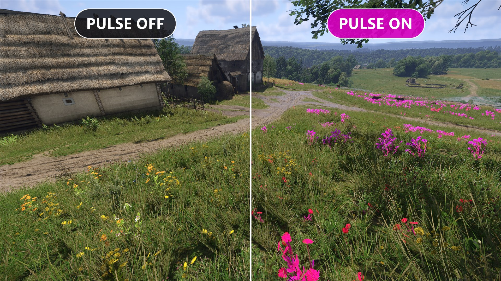
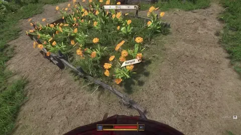

# Kingdom Come: Deliverance II mods

My mods for Kingdom Come: Deliverance II, ready to install. Each mod is a folder at the top of this repository, and each is independent of the others. The `docs` folder holds their screenshots and Nexus descriptions. The mods are built in a private repository. Only finished builds are published here.

They have been tested against game version 1.5.6 (Steam).

## Brighter Forage

Have you ever tried to find one particular weed in a meadow full of weeds? I have. For hours. Now the ones worth picking stand out, and so do nests, beehives, fish traps, buried treasure and graves. And one key lights them all up, for the days my eyes give up before I do.

[Read more](brighter_forage/README.md) · [Download 0.3.1](https://github.com/malvinly/kcd2/releases/tag/brighter_forage-v0.3.1)

## Instant Gather

There's a war on, in case nobody mentioned it. I haven't the time to get down on my knees for every Nettle in Bohemia. So now I just reach out and take it: no kneeling, no camera swinging round. Herbs and mushrooms both.

[Read more](instant_gather/README.md) · [Download 0.3.0](https://github.com/malvinly/kcd2/releases/tag/instant_gather-v0.3.0)

## Install

1. Download the mod's zip from [Releases](../../releases), or copy the mod's folder from this repository.
2. Put the mod's folder in `<game>\Mods\`, keeping the folder's name, such as `<game>\Mods\brighter_forage\`. A zip can be extracted straight into `<game>\Mods\`. Create the `Mods` folder if it isn't there.
3. Start the game.

`<game>` is the game's install folder. On Steam that is usually `C:\Program Files (x86)\Steam\steamapps\common\KingdomComeDeliverance2`.

To update a mod, delete its folder in `<game>\Mods\` and install the new version.

## Uninstall

Delete the mod's folder in `<game>\Mods\`.

## License

The [LICENSE](LICENSE) applies to my own work only. Game files inside the paks remain the property of Warhorse Studios.

These mods are not affiliated with or endorsed by Warhorse Studios or PLAION. Warhorse's [modding terms](https://www.deepsilver.com/games/kingdom-come-deliverance-ii/news/modding-in-kingdom-come-deliverance-2) don't allow mods to be sold.
