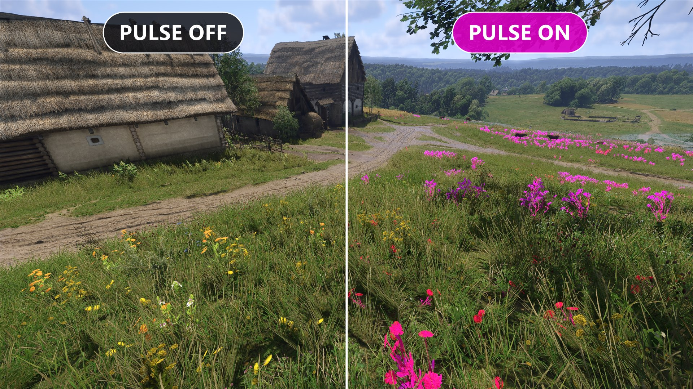
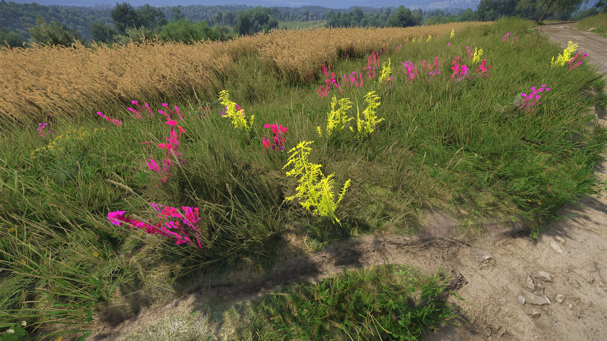

# Brighter Forage

> "Look for flowers in a meadow? Do I look like a bee to you?"
>
> Henry of Skalitz

Alright, look. I'm a blacksmith's son. I can forge a sword, lose at dice, and get knocked flat by a man half my size. What I can't do, it turns out, is tell Sage from the forty other green things growing next to it.

And everyone wants herbs. Every herb woman, every alchemist, every lad with a cough. It's always nine of something, and it's always the something that looks exactly like grass. So I've spent a fair bit of this war bent over in a meadow, squinting. Very heroic, I know.

This mod sorts that out. The things worth picking are brighter, so they stand out from the things that aren't. And for when that isn't enough, there's a key that lights up the lot.

## What it does

- **Herbs are brighter.** All sixteen kinds you can pick: Belladonna, Chamomile, Comfrey, Dandelion, Eyebright, Feverfew, Herb Paris, Marigold, Mint, Nettle, Poppy, Sage, St. John's wort, Thistle, Valerian and Wormwood.
- **Mushrooms too.** Amanita muscaria (fly agaric), Boletus edulis (penny bun) and Lepiota (parasol).
- **So are the other things people keep sending me after.** Bird's nests, beehives, fish traps, buried treasure and graves. Aye, graves. Don't look at me like that.
- **Everything else is left alone.** Grass is still grass. The fungi on trees and the stork nests keep their usual look, since there's nothing in them for me anyway.

It's the same plants in the same places, and nothing is added to the world. They're just easier to spot, for those of us who weren't raised by an apothecary.

## The pulse

Still can't see them? Fine. Neither can I, half the time.

- **Press F5.** Everything the mod covers glows bright magenta for 30 seconds, then goes back to normal.
- **Three of them glow gold instead:** Belladonna, Herb Paris and the fly agaric. They're the rare ones worth the walk. (One of the three versions makes it all magenta to start with. More on those below.)
- **Press it again** while they're lit and the count starts over.

Subtle it isn't. A proper herb woman would box my ears for it. But I've yet to see one find Wormwood any quicker.

## Which one to download

The mod comes in three versions. Not sure? Take the main one, two herb groups.

Is your computer a bit slow? A bit medieval, even? No shame in it. Look at what I ride. That's why there are three. Making herbs glow takes some doing, and where they grow thick, you lose a few frames.

All three make the same things brighter, and they look exactly the same until you press the key. The difference is how the herbs are split into groups.

A "group" is nothing clever. It's a handful of herbs that glow in one colour together. You can change that colour, but every herb in the group changes with it. And every group is a bit more work for your computer, whatever colour you give it.

- **Two herb groups: the main one, and the one I'd pick.** The herbs glow in two colours. Belladonna and Herb Paris glow gold, and the other fourteen glow magenta. You can change either colour, but not which herbs are in which group. About 5% slower.
- **One herb group: the easiest on your computer.** All sixteen herbs glow in one colour, magenta to start with. You can change it, but it's the same for every herb. About 3.5% slower. Pick this if your computer is slow, or you just want every frame you can get.
- **Every herb on its own: the hardest on your computer.** No groups at all. Each of the sixteen herbs can have a colour of its own, so you can choose your own herbs to glow gold, or switch off all but the ones you're looking for. About 11% slower. Pick this only if you want that, and your computer has frames to spare.

That's in a meadow full of herbs, which is as bad as it gets. Away from the herbs, none of the three slows the game at all.

Mushrooms, nests and all the rest can each have their own colour in every version, and that doesn't slow anything down.

**Install only one.** All three go into the same folder, so there's only room for one anyway.

## Install

1. Download one zip from [Releases](https://github.com/malvinly/kcd2/releases), under Assets. The one ending in `main` is two herb groups, the one ending in `one_herb_group` is one herb group, and the one ending in `full` is every herb on its own.
2. Extract it into `<game>\Mods\`, so you end up with `<game>\Mods\brighter_forage\`. Make the `Mods` folder if you don't have one.
3. Start the game and go and find a meadow.

`<game>` is where the game is installed. On Steam that's usually `C:\Program Files (x86)\Steam\steamapps\common\KingdomComeDeliverance2`.

**To update,** delete the old `brighter_forage` folder first, then put the new one in. If you changed `settings.cfg`, keep a copy before you delete, or you'll be setting your colours again.

**To switch to another version,** do the same: delete the old `brighter_forage` folder, then put the other one in. Each version has its own `settings.cfg`, so don't copy the old file across. Set your colours again in the new one.

## Uninstall

Delete `<game>\Mods\brighter_forage`. That's it. The mod keeps nothing in your saves, so the game goes back to how it was, and so do I. Squinting.

## Changing the settings

You can change the key, how long the pulse lasts, and the colours. It's all in one file. I know, I know, reading. I only learned this year myself. But there are notes above the lines, so you'll manage.

1. **Find the file.** It's `<game>\Mods\brighter_forage\settings.cfg`.
2. **Open it in Notepad.** Right-click it, choose Open with, then Notepad.
3. **Find the colour lines.** Each one looks like `brighter_forage_color nests magenta`: a name, then its colour. Lines starting with `--` are only notes.
4. **Change the last word** to `magenta`, `gold`, `off` (the key won't light it), or your own colour as three numbers with commas and no spaces, such as `20,14,0` (that one's gold, and `20,0,20` is magenta).
5. **To change the key,** find `bind f5 brighter_forage_pulse` and change `f5` to another key, such as `f6`, `g`, `np_1` (number pad) or `mouse4`. Pick one the game doesn't already use, or pressing it does both things.
6. **To change how long it lasts,** find `brighter_forage_seconds 30` and change the number. Any number of seconds above 0. Much longer than 30 hasn't been tried, so you're on your own there.
7. **Save the file** and start the game. If the game's already running, open the console with `~`, type `exec mods/brighter_forage/settings.cfg` and press Enter. If you changed the key, the old one keeps working too until you restart. Two keys. Wonderful.

**The names every version knows:**

- **`fly_agaric`, `parasol`, `penny_bun`:** the three mushrooms.
- **`nests`:** bird's nests.
- **`beehive_ab`, `beehive_c`, `beehive_g`, `honeycomb`:** the beehives and their honeycomb.
- **`fish_trap_a`, `fish_trap_b`, `fish_trap_c`:** the fish traps.
- **`buried_sack`, `buried_sack_forest`, `buried_sack_grassy`, `buried_sack_wet`:** buried treasure, in plain, forest, grassy and wet ground.
- **`grave_pit`, `grave_pit_dirt`, `grave_pit_forest`, `grave_pit_old`:** graves.

Set any of them to `off` and the key leaves it dark.

The herbs are where the three versions differ, so find yours below.

## Two herb groups (main file, about 5% slower)

**What it looks like:** press the key and Belladonna, Herb Paris and the fly agaric glow gold. Everything else glows magenta.

**The herb names:**

- **`herbs`:** Chamomile, Comfrey, Dandelion, Eyebright, Feverfew, Marigold, Mint, Nettle, Poppy, Sage, St. John's wort, Thistle, Valerian and Wormwood. One colour for all fourteen.
- **`herbs_gold`:** Belladonna and Herb Paris. One colour for both.

**Only after some of them?** Set a group to `off`. With `brighter_forage_color herbs off`, the only herbs the key lights are Belladonna and Herb Paris. `brighter_forage_color herbs_gold off` does the opposite.

You can't turn off one herb by itself, or move a herb from one group to the other. For that you want every herb on its own.

## One herb group (optional file, about 3.5% slower)

**What it looks like:** press the key and everything glows magenta. Herbs, mushrooms, nests, the lot.

**The herb names:**

- **`herbs`:** all sixteen herbs. One colour for the lot.

**Only after some of them?** `brighter_forage_color herbs off` leaves all sixteen herbs dark, so the key lights only the mushrooms, nests and the rest. It's all the herbs or none, mind. To pick and choose between herbs, you want every herb on its own.

Miss the gold fly agaric? Change its line to `brighter_forage_color fly_agaric gold`. Mushrooms don't slow anything down, so help yourself.

## Every herb on its own (optional file, about 11% slower)

**What it looks like:** the same as two herb groups. Belladonna, Herb Paris and the fly agaric glow gold, and everything else glows magenta.

**The herb names:**

- **`belladonna`, `chamomile`, `comfrey`, `dandelion`, `eyebright`, `feverfew`, `herb_paris`, `marigold`, `mint`, `nettle`, `poppy`, `sage`, `st_johns_wort`, `thistle`, `valerian`, `wormwood`:** the sixteen herbs, one name each.

**Only after some of them?** This is the version for it. Set every herb you don't want to `off`, and the key lights only the ones you're looking for. Hunting Sage? Turn the other fifteen off.

Or just be rid of the Nettles: `brighter_forage_color nettle off`. They sting like the devil.

## Good to know

- **Tested on game version 1.5.6 (Steam).**
- **Changing colours won't make it any quicker.** The groups are fixed in each version. Set both herb groups to the same colour and the game still does the work of two. For the easiest on your computer, install one herb group.
- **Keep a copy of `settings.cfg` before you update.** Installing or updating puts a fresh one in its place, and you'll be setting your colours again.
- **`off` only stops the key lighting it.** The thing is still brighter than usual the rest of the time, like everything else the mod covers.
- **Take a colour line out** and that thing glows magenta anyway. To leave it out, use `off`.
- **It won't get along with** any other mod that changes the same plants, nests, hives, traps, buried treasure or graves, or one that uses the same key. That means other mods that make herbs or nests easier to see. Pick one or the other.
- **Some things glow that you can't loot.** A few nests and hives are only there for decoration, like the ones at a fisherman's stall, and they get brighter and pulse all the same. I've been fooled. More than once.
- **The ground around buried treasure and graves** gets brighter along with them. I'd call that a favour.
- **Not everything's been looked at up close yet.** I've seen the herbs with my own eyes, and they look right. The mushrooms and the rest pulse as they should, but I haven't gone round and looked at every one of them out in the world yet.
- **After a game update,** the mod may need a new version. If the herbs look wrong after a patch, take it out until there is one.
- **It doesn't pick anything for you,** carry it, or brew it. And it won't feed me either. I still feel quite hungry.
- **It pairs well with [Instant Gather](../instant_gather/README.md).** This one finds the herbs, that one picks them without all the kneeling. My back sends its thanks.

God be with you. And if you do find the Belladonna, don't eat it.
