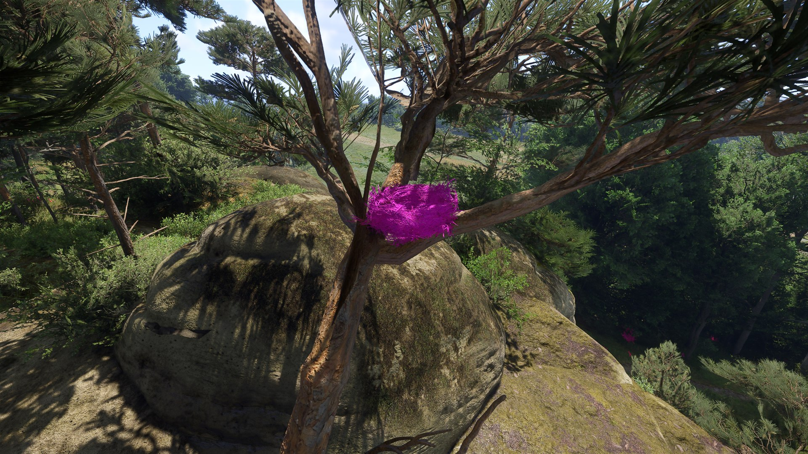

# Brighter Forage

> "Look for flowers in a meadow? Do I look like a bee to you?"
>
> Henry of Skalitz

Alright, look. I'm a blacksmith's son. I can forge a sword, lose at dice, and get knocked flat by a man half my size. What I can't do, it turns out, is tell Sage from the forty other green things growing next to it.

And everyone wants herbs. Every herb woman, every alchemist, every lad with a cough. It's always nine of something, and it's always the something that looks exactly like grass. So I've spent a fair bit of this war bent over in a meadow, squinting. Very heroic, I know.

This mod sorts that out. The things worth picking are brighter, so they stand out from the things that aren't. And for when that isn't enough, there's a key that lights up the lot.

## What it does

- **Herbs are brighter.** All sixteen kinds you can pick: Belladonna, Chamomile, Comfrey, Dandelion, Eyebright, Feverfew, Herb Paris, Marigold, Mint, Nettle, Poppy, Sage, St. John's wort, Thistle, Valerian and Wormwood.
- **Mushrooms too.** Amanita muscaria (fly agaric), Boletus edulis (penny bun) and Lepiota (parasol).
- **So are the other things people keep sending me after.** Bird's nests, beehives, fish traps, buried treasure and graves. Aye, graves. Don't look at me like that.
- **Everything else is left alone.** Grass is still grass. The fungi on trees and the stork nests keep their usual look, since there's nothing in them for me anyway.

It's the same plants in the same places, and nothing is added to the world. They're just easier to spot, for those of us who weren't raised by an apothecary.

## The pulse

Still can't see them? Fine. Neither can I, half the time.

- **Press F5.** Everything the mod covers glows bright magenta for 30 seconds, then goes back to normal.
- **Four of them glow gold instead:** Herb Paris, St. John's wort, Wormwood and Amanita muscaria.
- **Press it again** while they're lit and the count starts over.

Subtle it isn't. A proper herb woman would box my ears for it. But I've yet to see one find Wormwood any quicker.

## Changing the key, the time and the colours

There's a file called `settings.cfg` in the mod's folder. Open it in Notepad. I know, I know, reading. I only learned this year myself. But every line has a note above it, so you'll manage.

| What | The line in the file | What you can change |
| --- | --- | --- |
| The key | `bind f5 brighter_forage_pulse` | Change `f5` to another key, such as `f6`, `g`, `np_1` (number pad) or `mouse4`. Pick one the game doesn't already use, or pressing it does both things |
| How long it lasts | `brighter_forage_seconds 30` | Any number of seconds above 0. Much longer than 30 hasn't been tried, so you're on your own there |
| Each colour | `brighter_forage_color sage magenta` | One line per thing. Change the last word to `magenta`, `gold`, `off`, or your own colour as three numbers with commas and no spaces, such as `20,14,0` (that one's gold) |

- **`off`** leaves that one out of the pulse. Handy if you're sick of the sight of Nettles. I am. They sting like the devil.
- **Changes apply** the next time you start the game.
- **To apply them now,** open the console with `~`, type `exec mods/brighter_forage/settings.cfg` and press Enter. If you changed the key, the old one keeps working too until you restart. Two keys. Wonderful.

## Install

1. Download the zip from [Releases](https://github.com/malvinly/kcd2/releases).
2. Extract it into `<game>\Mods\`, so you end up with `<game>\Mods\brighter_forage\`. Make the `Mods` folder if you don't have one.
3. Start the game and go and find a meadow.

`<game>` is where the game is installed. On Steam that's usually `C:\Program Files (x86)\Steam\steamapps\common\KingdomComeDeliverance2`.

To update, delete the old `brighter_forage` folder first, then put the new one in. If you changed `settings.cfg`, keep a copy, or you'll be setting your colours again.

## Uninstall

Delete `<game>\Mods\brighter_forage`. That's it. The mod keeps nothing in your saves, so the game goes back to how it was, and so do I. Squinting.

## Good to know

- **Tested on game version 1.5.6 (Steam).**
- **It won't get along with** any other mod that changes the same plants, nests, hives, traps, buried treasure or graves, or one that uses the same key. That means other mods that make herbs or nests easier to see. Pick one or the other.
- **Some things glow that you can't loot.** A few nests and hives are only there for decoration, like the ones at a fisherman's stall, and they get brighter and pulse all the same. I've been fooled. More than once.
- **The ground around buried treasure and graves** gets brighter along with them. I'd call that a favour.
- **Not everything's been looked at up close yet.** I've seen the herbs with my own eyes, and they look right. The mushrooms and the rest pulse as they should, but I haven't gone round and looked at every one of them out in the world yet.
- **After a game update,** the mod may need a new version. If the herbs look wrong after a patch, take it out until there is one.
- **It doesn't pick anything for you,** carry it, or brew it. And it won't feed me either. I still feel quite hungry.
- **It pairs well with [Instant Gather](../instant_gather/README.md).** This one finds the herbs, that one picks them without all the kneeling. My back sends its thanks.

God be with you. And if you do find the Belladonna, don't eat it.
