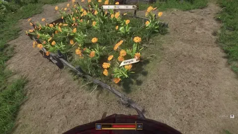

# Instant Gather

> "I don't have time to go skipping through meadows, picking flowers."
>
> Henry of Skalitz

Right. So you know how I pick a herb? I stop. I kneel. The whole world swings round so everyone can admire me from behind. I fuss about in the grass for a bit. Then I get up again. That's one Marigold. The herb woman wants thirty.

I've been stabbed, shot at and left for dead this year, and it's the kneeling that's going to finish my back off.

This mod sorts that out. I reach out a hand, I take the thing, and I'm on my way before anyone can ask me for a favour.

## What it does

- **No kneeling.** Gathering a herb or a mushroom is one quick reach of the arm, about a fifth of a second.
- **No swinging camera.** You stay looking out through my eyes, where you belong.
- **It still sounds right.** You get the same rustle as before, so you know something came out of the ground.
- **It works on anything with a "Gather" prompt.** That's every herb and every mushroom.
- **Nothing else changes.** Same plants in the same places. I'm just quicker about it.

Thirty Marigolds used to take me the better part of a morning. Now it takes about as long as it took you to read this. You're welcome.

## Install

1. Download the zip from [Releases](https://github.com/malvinly/kcd2/releases).
2. Open the zip and drag the `instant_gather` folder inside it into `<game>\Mods\`, so you end up with `<game>\Mods\instant_gather\`. Make the `Mods` folder if you don't have one.
3. Start the game and go and bother a meadow.

`<game>` is where the game is installed. On Steam that's usually `C:\Program Files (x86)\Steam\steamapps\common\KingdomComeDeliverance2`.

There's nothing to set up. No keys, no files to read. I thought you'd like that.

To update, delete the old `instant_gather` folder first, then put the new one in.

**When the game updates, delete `instant_gather` until a new version is out.** The mod carries its own copies of four game animation files, and after a patch they'd be out of date.

## Uninstall

Delete `<game>\Mods\instant_gather`. The mod keeps nothing in your saves, so the game goes back to how it was. Kneeling and all. Don't say I didn't warn you.

## Good to know

- **Tested on game version 1.5.6 (Steam).**
- **The HUD blinks.** It hides for a split second on every pick. That's the game's doing, not mine, and I haven't found a way round it.
- **It won't get along with** any other mod that changes the same four animation files. That means other mods that speed up herb picking, and some that change how I move. Pick one or the other.
- **Bird's nests aren't covered.** Those open like a chest, not like a herb, so I still have to rummage.
- **Everyone else still kneels.** The herb women carry on picking the slow way. I've decided not to tell them.
- **It pairs well with [Brighter Forage](../brighter_forage/README.md).** One finds the herbs, the other picks them. Between the two, I've almost no excuses left.

God be with you. And mind your back.
